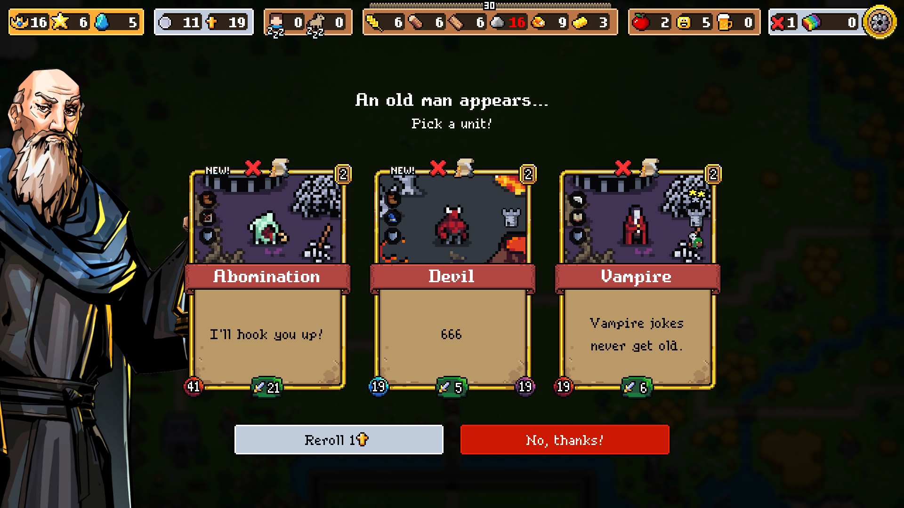
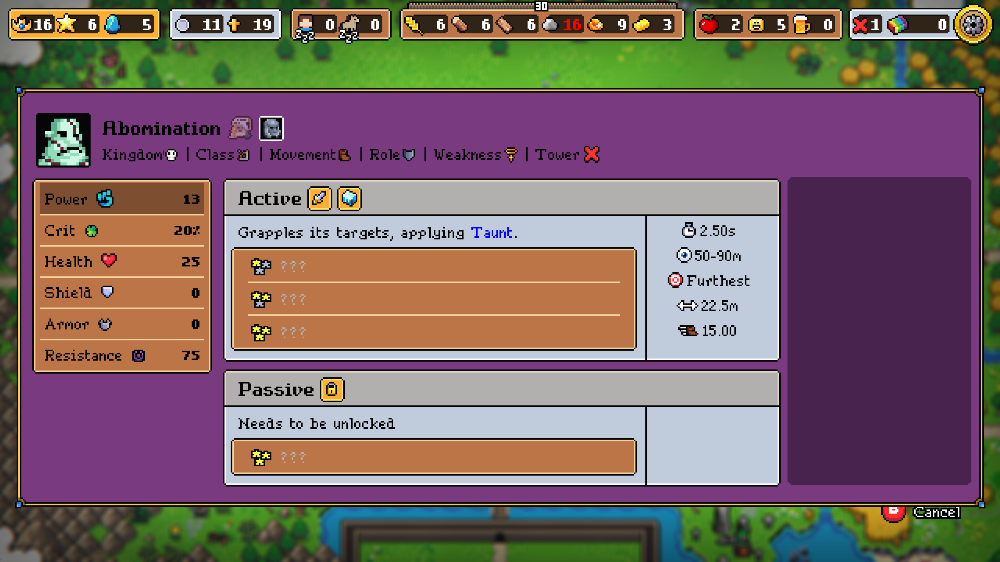

# Weekly Hermit

Meet the Hermit on Day 2 as usual, then get another chance to recruit every seven days in a standard kingdom run. The first return visits are on **Days 9, 16 and 23**.

## Features

- Choose from up to three eligible recruits from other kingdoms. The Hermit respects your unlocks and banishes and normally offers units you do not already own.
- Inspect a card before choosing. You can reroll for the displayed cost when enough candidates remain, or decline and keep playing.
- Finish the current visitor first. The Hermit waits through dialogue, cutscenes, and open or minimized merchant screens. If the map stays busy until day end, the visit expires and the next regular date still applies.
- Reloading the same dawn with the same eligible units reproduces the opening offer. If no units qualify, the Day 2 conversation still happens and the Hermit leaves without opening recruitment.

## How to Use

1. On a return day, finish any other encounter and return to the map. The Hermit’s recruitment screen opens automatically.
2. To inspect a recruit, click the scroll above its card. On a controller, use the **D-pad** to focus the scroll and press **A** on an Xbox controller. Press **B** to return to the offer.
3. Click the card to recruit, or confirm the focused card with **Enter** on a keyboard or **A** on an Xbox controller. Place the recruit using the game’s usual placement controls. To pass for the day, select **No, thanks!** and confirm.
4. If another mod adds a price, select **Buy** for that unit. After inspecting, controller focus returns to Buy if you can afford it, or to the decline button otherwise.

## Screenshots

*Day 16, after [Daily Caravan](https://thunderstore.io/c/super-fantasy-kingdom/p/GKJ/DailyCaravan/) finished. Each scroll opens the details for the card beneath it.*

*Inspecting Abomination before recruiting. Both captures are from Weekly Hermit 0.1.0 at 1.5× UI scale with simulated gamepad input.*

## Compatibility

- Challenges keep their own Hermit schedule.
- With [Daily Caravan](https://thunderstore.io/c/super-fantasy-kingdom/p/GKJ/DailyCaravan/) and [Visitor Calendar](https://thunderstore.io/c/super-fantasy-kingdom/p/GKJ/VisitorCalendar/), both visitors can appear on the Day 16 calendar. The Hermit waits while the Caravan is minimized and offers recruits after it finishes.
- [UnlimitedJail 1.2.0](https://thunderstore.io/c/super-fantasy-kingdom/p/ownlyme/UnlimitedJail/) was tested in-game. Jailed units stayed out of the offer. For unit mods, eligibility follows the game’s active recruitment pool. Removed units drop out on reload, and an owned unit can rank up only when both the Hermit and merchant allow it.

## Installation

1. In Thunderstore Mod Manager or [r2modman](https://thunderstore.io/c/super-fantasy-kingdom/p/ebkr/r2modman/), select **Super Fantasy Kingdom** and install **WeeklyHermit** by **GKJ** with both required packages, [BepInExPack](https://thunderstore.io/c/super-fantasy-kingdom/p/BepInEx/BepInExPack/) and [HideManagerGameObject_Config](https://thunderstore.io/c/super-fantasy-kingdom/p/BepInEx/HideManagerGameObject_Config/).
2. Launch with **Start modded**. To change the seven-day interval, edit `IntervalDays` under `[Schedule]` in `BepInEx/config/gkj.superfantasykingdom.weeklyhermit.cfg` after the first launch. Choose 1–365 days and restart the game. Visits are counted from Day 2.
