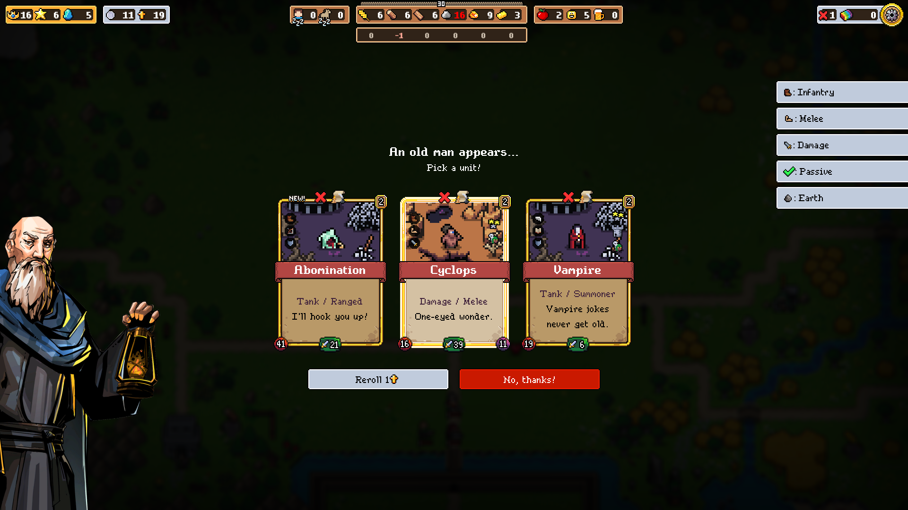
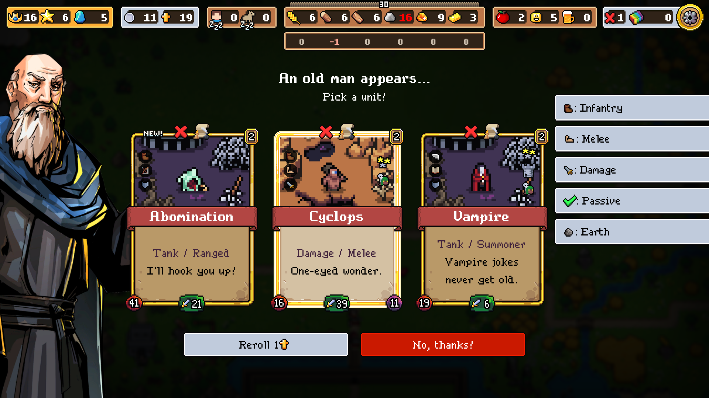
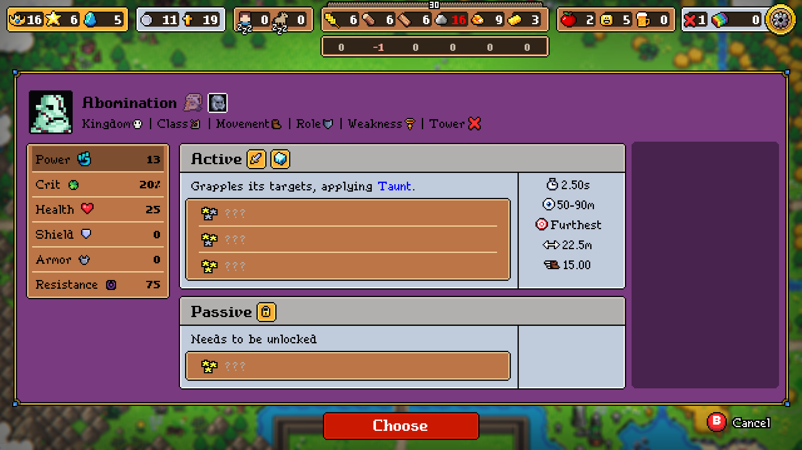

# Weekly Hermit

Meet the Hermit on Day 2 as usual, then get another chance to recruit every seven days in a standard kingdom run. The first return visits are on **Days 9, 16 and 23**.

## Features

- Choose from up to three eligible recruits from other kingdoms. The Hermit respects your unlocks and banishes and normally offers units you do not already own.
- Compare each recruit’s role and attack style above its quote when there is room. The highlighted frame shows which unit you will recruit if you confirm.
- Inspect a card before choosing. You can reroll for the displayed cost when enough candidates remain, or decline and keep playing.
- Finish the current visitor first. The Hermit waits through dialogue, cutscenes, and open or minimized merchant screens. If the map stays busy until day end, the visit expires and the next regular date still applies.
- Reloading the same dawn with the same eligible units reproduces the opening offer. If no units qualify, the Day 2 conversation still happens and the Hermit leaves without opening recruitment.

## How to Use

1. On a return day, finish any other encounter and return to the map. The Hermit’s recruitment screen opens automatically.
2. To inspect a recruit, click the scroll above its card. On a controller, use the **D-pad** to focus the scroll and press **A** on an Xbox controller. Press **B** to return to the same recruit.
3. Click the card to recruit, or confirm the focused card with **Enter** on a keyboard or **A** on an Xbox controller. Place the recruit using the game’s usual placement controls. To pass for the day, select **No, thanks!** and confirm.
4. If another mod adds a price, select **Buy** for that unit. After inspecting, controller focus returns to Buy if you can afford it, or to the decline button otherwise.

## Screenshots

*At 1×, Cyclops has controller focus. Each card shows its role, attack style and stats. Reroll and decline are below the cards.*

*At 1.5×, the keyword panel on the right leaves all three rank badges visible.*

*Inspect opens the recruit’s stat sheet. Choose and Cancel remain visible below it.*

## Compatibility

- Works with Super Fantasy Kingdom **0.8.068** and the other [GKJ mods](https://thunderstore.io/c/super-fantasy-kingdom/p/GKJ/).
- [Daily Caravan](https://thunderstore.io/c/super-fantasy-kingdom/p/GKJ/DailyCaravan/) and the Hermit can share a dawn. The Hermit waits for another active or minimized visitor to finish, and [Visitor Calendar](https://thunderstore.io/c/super-fantasy-kingdom/p/GKJ/VisitorCalendar/) can show both visits.
- The Hermit uses the game’s active recruit pool. Banned, jailed, locked, or removed units stay out of offers, including with [Unlimited Jail](https://thunderstore.io/c/super-fantasy-kingdom/p/ownlyme/UnlimitedJail/). An owned unit can rank up only when both the Hermit and merchant allow it.
- Challenges keep their own Hermit schedule.
- These community mods can share the same profile. [Achievement Enabler](https://thunderstore.io/c/super-fantasy-kingdom/p/ownlyme/AchievementEnabler/), [Bakery Uses Wheat](https://thunderstore.io/c/super-fantasy-kingdom/p/ownlyme/BakeryUsesWheat/), [More Relics](https://thunderstore.io/c/super-fantasy-kingdom/p/ownlyme/MoreRelics/), [Right Click Skip](https://thunderstore.io/c/super-fantasy-kingdom/p/ownlyme/RightClickSkip/), and [Tavern Food Priorities](https://thunderstore.io/c/super-fantasy-kingdom/p/ownlyme/TavernFoodPriorities/).

## Installation

1. In Thunderstore Mod Manager or [r2modman](https://thunderstore.io/c/super-fantasy-kingdom/p/ebkr/r2modman/), select **Super Fantasy Kingdom** and install **WeeklyHermit** by **GKJ** with both required packages, [BepInExPack](https://thunderstore.io/c/super-fantasy-kingdom/p/BepInEx/BepInExPack/) and [HideManagerGameObject_Config](https://thunderstore.io/c/super-fantasy-kingdom/p/BepInEx/HideManagerGameObject_Config/).
2. Launch with **Start modded**. To change the seven-day interval, edit `IntervalDays` under `[Schedule]` in `BepInEx/config/gkj.superfantasykingdom.weeklyhermit.cfg` after the first launch. Choose 1–365 days and restart the game. Visits are counted from Day 2.

## Support

[Support GKJ Games on Ko-fi](https://ko-fi.com/gkj_games)
